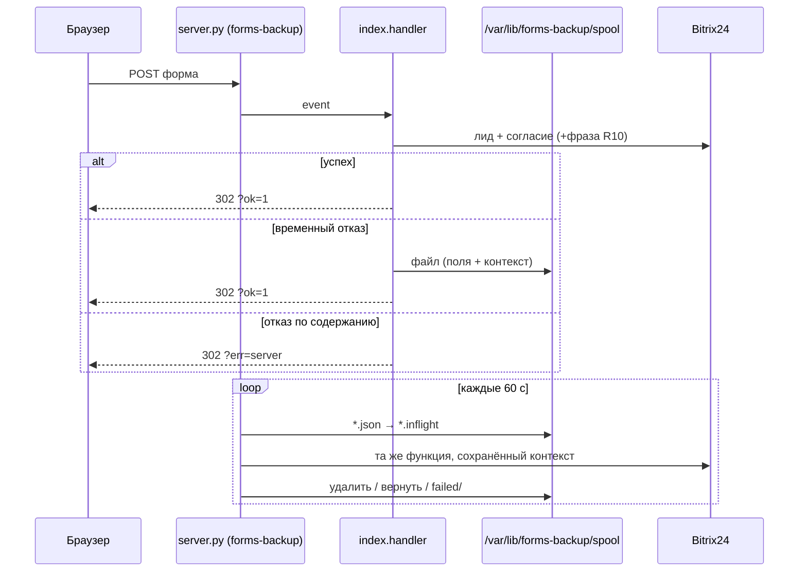

# Резерв форм forms-failover — живой проход 5/5 без потери лида - Plan

**Target repo:** arwox-v3-src. Эпик bd `dcfg-1ci20`, spec:103 v3.

---

## Goal Capsule

- **Objective.** При сбое шлюза Яндекса заявка с формы arwox.ru попадает в Bitrix24 через резерв. Ход теста понятен без чтения логов: видно этап, причину сбоя и момент, когда можно тестировать.
- **Means.** Точечные правки существующих `forms-failover/*` и `index.py`, без новых процессов и сервисов (KTD1, KTD2).
- **Authority.** `/etc/claude-code/CLAUDE.md` > `/root/CLAUDE.md` > `projects/CLAUDE.md` > этот план.
- **Stop.** Агент сам запустил `./demo.sh simulate` → «🏁 Тест пройден: 5/5», затем `./demo.sh restore` → CNAME на 6/6 NS Beget; боевой `forms.arwox.ru` защищён проверкой DNS-провайдера (U7); `bd list --parent dcfg-1ci20 --status open,in_progress` = 0. Дальше — ничего.
- **v2 09.10.** Добавлены U7 (боевой резерв без своего опроса, атом `.32`) и U8 (этап 5 demo, атом `.31`). Новых планов, спек и атомов нет — запрет дублей владельца.
- **Execution profile.** Каждый U с кодом = один атом bd = одна ветка `.worktrees/claude/<атом>` = один коммит через Workflow code-atom → `tools/bin/code-channel auto`; доставка `tools/bin/ship`. Владелец команд не запускает.

---

## Product Contract

### Summary

Чиним крах сторожа после переключения DNS, делаем ход теста честным и читаемым, сохраняем заявку при временном отказе Bitrix24 на резерве и помечаем такие сделки одной фразой. Завершает работу живой прогон агентом.

### Problem Frame

Факты 09.10:
- Живой тест 08:54 переключил DNS, но сторож падал каждую минуту: `forms-gw-guard.sh: line 205: result: unbound variable`. Режим `outage` не записан, сертификат не запрошен. Исправлено атомом `dcfg-1ci20.27` (PR #7, a2c8c14).
- `restore` 09:02–09:06 вернул домен в Яндекс, но DNS остался A 45.139.76.176: сторож возвращает DNS только из своего режима `outage`, а режим не был записан. `demo.log` закончился `restore result rc=0` без CNAME. Ветка «✅ Уже восстановлено» (`demo.sh:210`) выходит с 0, не глядя на DNS. DNS вернул агент вручную (`dns-switch.sh status` → `normal`).
- `demo.sh status` во время outage → exit 4: `dns-switch.sh` без `BEGET_IP` видит `foreign` (`demo.sh:6` не экспортирует переменную).
- Прогресс `demo.sh` печатает одинаковую строку каждые 15 с.
- Лог сторожа пишет `ssl request rc=` и `le rc=` об одном событии.
- При отказе `crm.lead.add` обработчик редиректит на `?err=server` и заявку не хранит (`index.py:274-277`). Очереди в репо нет.

### Requirements

**Сторож**
- R1. После переключения DNS сторож записывает режим `outage`, шлёт одно уведомление и запускает шаг сертификата — также при пустых `FALLBACK_PAGE_ID`/`FALLBACK_BLOCK_ID`.
- R2. Неудачное переключение DNS сохраняет один снимок инцидента на серию неудач.
- R3. Одно событие сертификата — одна строка лога.

**Ход теста**
- R4. `demo.sh` печатает строку прогресса только при изменении этапа, числа NS или события сторожа.
- R5. После этапа 4 `demo.sh` печатает строку `🟢 МОЖНО ТЕСТИРОВАТЬ: откройте форму https://forms-test.arwox.ru/`.
- R6. Сбой своей проверки завершает `demo.sh` одной строкой «❌ <этап>: <причина>» и ненулевым кодом, без повторов по кругу. Сбой — это строка `unbound variable` или `line N:` в журнале ошибок сторожа (сразу), таймаут этапа 20 мин, прерывание (код 130).
- R7. `restore` завершается с 0 только при CNAME на 6/6 NS, в том числе когда домен уже привязан к шлюзу. Если DNS не вернулся за 10 мин, `restore` возвращает его через `dns-switch.sh apply normal`, ждёт 6/6 и печатает «⚠️ сторож не вернул DNS — возвращено тестом».
- R8. `demo.sh status` работает и в режиме outage.

**Заявка на резерве**
- R9. На резерве при временном отказе Bitrix24 (сеть, таймаут, 429, 5xx) заявка сохраняется, пользователь получает редирект успеха, резерв досылает её. Отказ Bitrix24 по содержанию идёт прежним путём `?err=server`.
- R10. Лид, созданный резервом сразу или досылкой, несёт в комментарии фразу «Форма была отправлена во время сбоя при резервном переключении».
- R11. Функция Яндекса ведёт себя как раньше: без переменных резерва нет ни очереди, ни фразы.
- R12. Досланный лид получает запись согласия с исходными временем, IP, User-Agent и `ref_origin` заявки.

**Боевой адрес**
- R13. При недоступности шлюза Яндекса `forms.arwox.ru` за ≤15 мин указывает на резерв 45.139.76.176 и обратно после восстановления. Проверку и переключение делает DNS-провайдер; своих процессов для этого нет.
- R14. На резерве для `forms.arwox.ru` действует сертификат до переключения: `curl --resolve forms.arwox.ru:443:45.139.76.176` → 302 без ошибки TLS.
- R15. Живой проход demo проходит этап 5: проба резерва шлёт CONSENT; успех — 302 `?ok=1#sent` или 200 со страницей капчи, итог называет исход (атом `.31`).

### Key Decisions

- **Код — только через code-channel, один атом = один коммит.** (session-settled: user-directed — chosen over ce-work/ce-commit-push-pr напрямую: закон projects/CLAUDE.md «Руки», «ГРАНИЦА КОММИТА».) Governs U1–U8.
- **NPM — только `npm_ssl_request.sh`.** (session-settled: user-directed — chosen over правки nginx/контейнера: «сложный продукт, сожжём лимиты».) Governs R1, R14.
- **Без новых скриптов-дублей и процессов.** (session-settled: user-directed — chosen over новые скрипты/сервисы: запрет дублей владельца.) Тестовые файлы — не дубли и допустимы. Governs R9.
- **Фраза сделки дословно.** (session-settled: user-directed — chosen over длинное описание: «одним предложением».) Governs R10.
- **Никаких своих процессов ожидания, опроса и пинга для переключения боевого адреса.** (session-settled: user-directed — chosen over усиление forms-gw-guard: cron каждую минуту + DNS_SWITCH: процесс-наблюдатель — единая точка отказа, на сервере ~100 процессов.) Governs R13.
- **Проверку доступности и переключение делает DNS-провайдер.** (session-settled: user-directed — chosen over «форма всегда шлёт на наш сервер»: выбор владельца «2» 09.10.) Governs R13.
- **Переключение до 15 мин допустимо.** (session-settled: user-directed — chosen over секундный failover: «15 мин не страшно», поток лидов малый.) Governs R13.
- **demo.sh с flock и идемпотентностью — база.** (session-settled: user-approved — chosen over запуск без замка: 09.10 два restore → FailedPrecondition.) Governs R4–R8.

### Scope Boundaries

- `demo.sh` боевой `forms.arwox.ru` не трогает (`demo.sh:9` отказ); боевой адрес меняет только U7.
- Боевой `forms-gw-guard` (cron 15 мин, без `DNS_SWITCH`, `ecosystem.config.js:221-238`) не меняется: к переключению U7 он не причастен. Его удаление — вне цели, строка bd.
- Окно, пока DNS ещё на мёртвом шлюзе: заявка остаётся в браузере. Повтор из браузера невозможен — лендинг Bitrix24 без JS (`index.py:2-4`). Строка в bd, не делать.
- Машинный источник статуса Яндекса не найден: status.yandex.cloud рендерится JS (UNVERIFIED). Вне плана.
- Анимированный статус-бар — нет (R4).

---

## Planning Contract

### Key Technical Decisions

- KTD1. Очередь — каталог JSON-файлов вне репозитория: `LEAD_SPOOL_DIR`, по умолчанию `/var/lib/forms-backup/spool`. Каталог 0700, файлы 0600 (umask 077), запись tmp + rename, имя — случайный id. Потолок 500 файлов; при переполнении — прежний путь `?err=server`.
- KTD2. Досылку делает один поток внутри `server.py` раз в 60 с, без повторного входа. Перед отправкой файл переименовывается в `*.inflight`; при отказе — обратно. Только этот процесс знает `WEBHOOK_URL`.
- KTD3. `server.py` ставит `LEAD_SPOOL_DIR` и `LEAD_FAILOVER_NOTE` через `os.environ.setdefault` до `import index`. Ecosystem в tools не меняется, функция Яндекса их не видит (R11).
- KTD4. Шаг «создать лид + согласие» в `index.py` — одна функция. Файл очереди хранит её входы: поля лида, `ip`, `user_agent`, исходное время, `ref_origin`, `form_content`. Досылка вызывает ту же функцию с сохранённым контекстом (R12). Капча повторно не проверяется: она пройдена до записи.
- KTD5. Классы отказа: временный (сеть, таймаут, 429, 5xx) → очередь; по содержанию (4xx, `error` в ответе) → `?err=server`. Файл старше 24 ч или после 100 попыток переносится в `failed/` со строкой лога. Дубль лида при потерянном ответе Bitrix24 принимается: дубль лучше потери.
- KTD6. Логи очереди содержат только счётчики, id файла и код ошибки — без полей заявки и тела ответа Bitrix24.
- KTD7. Из двух строк сертификата остаётся `ssl request rc=` (её читает `demo.sh:79-80`); `log le "rc=$rc"` удаляется.
- KTD8. Снимок неудачи — флаг `dns_fail_snapshot` в state сторожа; сбрасывается при успешном переключении.
- KTD10. DNS-провайдер — ClouDNS DNS Failover. Beget health-check не даёт (bd `research-beget-api`); у Yandex Cloud DNS и Selectel проверки не найдены. ClouDNS: «supported both for IPv4 A records and IPv6 AAAA records»; действие «Replace with working IP» и «Activate the main IP if it is back up»; DOWN — «from two different checks on two different locations» (https://www.cloudns.net/wiki/article/271/, WebFetch 09.10). Тариф Premium S, 1 проверка (https://www.cloudns.net/dns-failover — UNVERIFIED, со слов исследователя).
- KTD11. Делегирование только поддомена: Beget changeRecords «NS-записи (для поддоменов)» (https://beget.com/ru/kb/api/funkczii-upravleniya-dns, WebFetch 09.10) — `forms.arwox.ru` NS → ClouDNS. Зона arwox.ru остаётся у Beget. В существующем `dns-switch.sh` появляется режим `delegated`: `status` узнаёт NS ClouDNS (rc 0), `apply delegate` шлёт тело `{NS:[…]}`, `apply normal` принимает `delegated` как исходное состояние и восстанавливает все записи из снимка. Сейчас скрипт видит NS как `foreign` и завершается с rc 4 (`dns-switch.sh:59-66`), а тело строит только `{A}`/`{CNAME}` (`:74-76`). Снимок перед delegate — всегда новый файл с меткой времени (сейчас `:69` не перезаписывает). Имена NS ClouDNS — переменная окружения.
- KTD12. Перенос в ClouDNS — две записи, каждая отдельным `getData` и сверкой `dig @<NS ClouDNS>` с `dig @ns1.beget.pro` до delegate: `forms.arwox.ru` и `_acme-challenge.forms.arwox.ru CNAME fpqtqp780aff9ihjp9qr.cm.yandexcloud.net` (dig 09.10). В зоне `forms.arwox.ru` — A на IP шлюза Яндекса (main) и backup 45.139.76.176: CNAME ClouDNS failover не поддерживает. Проверка — HTTPS на путь `/health` с Host `forms.arwox.ru`: голый TCP на общем IP шлюза может остаться UP при мёртвом шлюзе. Сама форма отвечает 302 — для проверки в `gateway-spec.yaml` добавляется маршрут `/health` с интеграцией `dummy` и `http_code: 200` («returns fixed content with the specified response code», https://yandex.cloud/en/docs/api-gateway/concepts/extensions/dummy). Поддержка в ClouDNS своего Host и пути для HTTPS-проверки — UNVERIFIED, сверяется до настройки. Если её нет — TCP 443, риск записан в Risks.
- KTD13. Сертификат резерва — Let's Encrypt HTTP-01, штатное продление NPM. DNS-01 невозможен: `_acme-challenge.forms` — CNAME на Certificate Manager Яндекса, а TXT рядом с CNAME не встаёт. В `gateway-spec.yaml` добавляется маршрут `/.well-known/acme-challenge/{token}` с интеграцией `http` на `http://45.139.76.176/.well-known/acme-challenge/{token}` с заголовком `Host: forms.arwox.ru` («The parameters are subsituted into `url`», https://yandex.cloud/en/docs/api-gateway/concepts/extensions/http). Тогда проверка LE проходит через шлюз в NPM host 40 до переключения, а после — напрямую. Выпуск — существующий `npm_ssl_request.sh` без изменений. Делегирование не нужно для сертификата, ключ ClouDNS в NPM не попадает.
- KTD14. Порядок без окна без сертификата: маршруты шлюза → сертификат резерва (R14) → зона ClouDNS с выключенной failover-проверкой → delegate → включение проверки → замер на одноразовой записи.
- KTD9. `demo.sh` ловит свой сбой по новым строкам `forms-gw-guard-test-error.log` с момента старта, по шаблонам R6. `BEGET_IP` экспортируется для дочернего `dns-switch.sh`.

### High-Level Technical Design

---

## Implementation Units

### U1. Сторож: `result` при одном DNS_SWITCH

- **Goal:** R1. Атом `dcfg-1ci20.27` — закрыт, PR #7 смёржен (a2c8c14).
- **Files:** `forms-failover/forms-gw-guard.sh`, `forms-failover/forms-gw-guard-test.sh`.
- **Verification:** `PASS 24/24` получен 09.10.

### U2. Сторож: снимок при неудаче и одна строка сертификата

- **Goal:** R2, R3. Атом `dcfg-1ci20.23` (reopened), ТЗ v2.
- **Dependencies:** U1.
- **Files:** `forms-failover/forms-gw-guard.sh`, `forms-failover/forms-gw-guard-test.sh`.
- **Approach:**
  1. В ветке `dns switch failed` вызвать существующий `incident_snapshot`, если флаг KTD8 не стоит.
  2. Удалить `log le "rc=$rc"` (KTD7).
  3. Новые кейсы — продолжение нумерации и литералов `PASS N/N` в тест-файле.
- **Test scenarios:**
  - Три подряд неудачи DNS_SWITCH → один новый каталог в `state/incidents`, одно уведомление.
  - Неудача, затем успех, затем неудача → два снимка.
  - Шаг сертификата → ровно одна строка `ssl request rc=`.
- **Verification:** тест-набор сторожа зелёный; `grep -c 'log le' forms-gw-guard.sh` = 0.

### U3. demo.sh: честный ход теста

- **Goal:** R4–R8. Новый атом.
- **Dependencies:** U1.
- **Files:** `forms-failover/demo.sh`, новый `forms-failover/demo-test.sh`, `forms-failover/README.md`.
- **Approach:**
  1. `progress` хранит последнюю строку без времени и печатает только новую (R4).
  2. После `complete_stage 4` — строка R5.
  3. Проверка журнала ошибок сторожа в каждом цикле ожидания (KTD9).
  4. `trap` на INT/TERM → код 130.
  5. `restore`: ветка «уже привязан» и обычная ведут к одной проверке 6/6 NS; таймаут 10 мин → `dns-switch.sh apply normal` (R7).
  6. `export BEGET_IP` (KTD9).
  7. README: что видит владелец и когда тестировать.
- **Execution note:** стенда для demo.sh нет — `demo-test.sh` создаётся с заглушками `dig`, `yc`, `curl`, `dns-switch.sh` через PATH, по образцу заглушек `forms-gw-guard-test.sh`. Без сети.
- **Test scenarios:**
  - Три одинаковых опроса → одна строка прогресса.
  - Этап 4 пройден → строка `🟢 МОЖНО ТЕСТИРОВАТЬ`.
  - В журнале ошибок появилась `unbound variable` → выход ≠0 с её текстом в первом же цикле.
  - Безобидная строка stderr без шаблона → тест идёт дальше.
  - INT во время ожидания → `demo.log` содержит `rc=130`.
  - restore: домен уже привязан, DNS на A → вызван `apply normal`, итог CNAME 6/6, строка «⚠️».
  - Повторный restore при CNAME 6/6 → «✅ Уже восстановлено», rc 0.
  - status при outage → rc 0, `dns=outage`.
- **Verification:** `bash forms-failover/demo-test.sh` → `PASS N/N`; `bash -n` rc 0.

### U4. Фраза сделки от резерва

- **Goal:** R10, R11. Новый атом.
- **Dependencies:** нет.
- **Files:** `site78-releases/2026-07-29/backend-arwox-lead-form/index.py`, `forms-failover/server.py`, `forms-failover/server-test.py`.
- **Approach:** при непустом `LEAD_FAILOVER_NOTE` фраза — первая строка `fields[COMMENTS]` (`index.py:228-253`); `server.py` задаёт её через `setdefault` (KTD3).
- **Test scenarios:**
  - С переменной → `fields[COMMENTS]` начинается с фразы, маркер формы сохранён.
  - Без переменной → поля как раньше.
- **Verification:** `python3 forms-failover/server-test.py` зелёный; фраза в коде совпадает побайтно с R10.

### U5. Очередь заявок на резерве

- **Goal:** R9, R12. Новый атом.
- **Dependencies:** U4 (тот же файл).
- **Files:** `site78-releases/2026-07-29/backend-arwox-lead-form/index.py`, `forms-failover/server.py`, `forms-failover/server-test.py`.
- **Approach:**
  1. Выделить функцию «лид + согласие» с явным контекстом (KTD4).
  2. Классификация отказа и запись файла (KTD1, KTD5).
  3. Поток-досыльщик в `server.py` (KTD2), логи по KTD6.
- **Test scenarios:**
  - Сеть/5xx → файл в очереди с правами 0600, ответ 302 `?ok=1#sent`.
  - 4xx → файла нет, ответ `?err=server`.
  - Досылка, Bitrix24 ответил → файл удалён, лид с фразой R10, согласие с исходными IP и временем.
  - Досылка, временный отказ → файл вернулся из `*.inflight`.
  - Файл старше 24 ч → перенесён в `failed/`.
  - Битый JSON → `failed/`, остальные файлы обработаны.
  - 500 файлов → новая заявка идёт путём `?err=server`.
  - После отказа телефон тестовой заявки не встречается в stderr.
  - Без `LEAD_SPOOL_DIR` → прежний `?err=server`.
- **Verification:** `python3 forms-failover/server-test.py` зелёный; после выкладки `pm2 restart forms-backup` и лог без ошибок.

### U6. Живой проход и закрытие эпика

- **Goal:** Stop из Goal Capsule. Закрывает атом `dcfg-1ci20.14` (тестовый поддомен) и эпик.
- **Dependencies:** U2–U5 и U8 смёржены, живой checkout обновлён, pm2 forms-backup перезапущен.
- **Approach:**
  1. Агент запускает `./demo.sh simulate` в фоне с таймаутом и ждёт итог.
  2. «🏁 5/5» → `./demo.sh restore` → `dns-switch.sh status` = `normal`.
  3. Провал → строка «❌» = находка bd, стадия 2 (диагностика), без повтора вслепую; DNS возвращает `restore`.
- **Test expectation:** none — это живая приёмка, а не код.
- **Verification:** вывод `simulate` с «🏁 Тест пройден: 5/5»; `dns-switch.sh status` = `normal`; `bd list --parent dcfg-1ci20 --status open,in_progress` = 0.

### U7. Боевой резерв: проверка и переключение у DNS-провайдера

- **Goal:** R13, R14. Атом `dcfg-1ci20.32`, ТЗ v2 того же файла `docs/tz/2026-10-09-dcfg-1ci20.32-prod-guard-dns.md` (v1 со сторожем отменён решением «без опроса»).
- **Dependencies:** аккаунт ClouDNS Premium S оплачен владельцем, ключ API лежит в `/root/workspaces/secrets/` (Контрольная точка — оплата и логин).
- **Files:** `site78-releases/2026-07-29/backend-arwox-lead-form/gateway-spec.yaml`, `forms-failover/dns-switch.sh`, тест-кейсы рядом, `forms-failover/README.md`. Один репо — один коммит; `npm_ssl_request.sh` не меняется (KTD13).
- **Approach (порядок KTD14):**
  1. `gateway-spec.yaml`: маршруты `/health` (dummy 200) и `/.well-known/acme-challenge/{token}` (http на резерв, KTD13); выкладка спеки шлюза.
  2. Сертификат резерва: `npm_ssl_request.sh` для host 40; проверка R14.
  3. Зона ClouDNS: записи KTD12, A main + backup, «Replace with working IP», «Activate the main IP if it is back up», TTL 300, проверка выключена; сверка `dig @<NS ClouDNS>` с Beget по двум именам.
  4. `dns-switch.sh apply delegate` (KTD11), новый снимок.
  5. Включить проверку; одноразовая запись `ft.forms.arwox.ru` с теми же настройками, main — IP с закрытым 443, backup 45.139.76.176: замер времени до backup в `dig @<NS ClouDNS>` (≤15 мин) и возврата; запись удалить; числа — в bd.
- **Execution note:** доступ к аккаунту ClouDNS — 2FA, отдельная почта, ключ API ограничен по IP, если тариф позволяет; файл ключа 0600; значение ключа не попадает в лог, state и снимки.
- **Test scenarios:** `apply delegate` с заглушкой API → тело `{NS:[…]}` и новый снимок при уже существующем; `status` при NS ClouDNS → `delegated`, rc 0; `apply normal` из `delegated` → тело с CNAME `forms` и CNAME `_acme-challenge` из снимка.
- **Verification:** тест-файлы зелёные; `curl -o /dev/null -w '%{http_code}' https://forms.arwox.ru/health` → 200; `curl --resolve forms.arwox.ru:443:45.139.76.176 -o /dev/null -w '%{http_code}' https://forms.arwox.ru/` → 302; `dig +short NS forms.arwox.ru` → NS ClouDNS; `dig +short _acme-challenge.forms.arwox.ru` → `fpqtqp780aff9ihjp9qr.cm.yandexcloud.net.`; замер п.5 ≤15 мин; `curl https://forms.arwox.ru/` → 302.

### U8. Этап 5 demo: проба с согласием

- **Goal:** R15. Атом `dcfg-1ci20.31`; разблокирует `.14`.
- **Dependencies:** U3 (тот же файл).
- **Files:** `forms-failover/demo.sh`, `forms-failover/demo-test.sh`.
- **Approach:** проба этапа 5 шлёт `CONSENT`. Два исхода, оба — успех этапа: 302 `?ok=1#sent` (капчи нет, лид создан) или 200 со страницей SmartCaptcha (`_captcha_page`, `index.py:370-374`; резерв доступен, лид не создаётся). Строка итога называет исход. Доставку лида через резерв доказывает `server-test.py` (U5), не этап 5. Переменную капчи агент не читает (запрет `.env`). Факт 09.10: `grep -c SMARTCAPTCHA` в `ecosystem.config.js` и `server.py` = 0 — на резерве капчи нет. Критерий атома `.31` «200 с captcha.js» требует секрета в окружении forms-backup (секреты и ecosystem — deny) — Контрольная точка; смена критерия — словом владельца.
- **Test scenarios:** 302 `?ok=1#sent` → этап 5 ✅ «лид принят»; 200 с маркером капчи → ✅ «резерв доступен, капча включена»; 302 `?err=consent` → ❌.
- **Verification:** `bash forms-failover/demo-test.sh` → `PASS N/N`; живой проход U6 «🏁 5/5».

---

## Verification Contract

- Сторож: `bash forms-failover/forms-gw-guard-test.sh` → `PASS N/N`.
- demo: `bash forms-failover/demo-test.sh` → `PASS N/N`.
- Резерв: `python3 forms-failover/server-test.py`.
- Синтаксис: `bash -n` для изменённых `.sh`, `python3 -m py_compile` для `.py`.
- Живой проход — U6.
- Боевой резерв — проверки Verification U7, включая замер ≤15 мин.

## Definition of Done

- U2–U8 закрыты в bd с SHA или выводом, командой и числом. U7 BLOCKED (нет аккаунта ClouDNS) → итог PARTIAL, боевой DNS не меняется.
- Живой «🏁 5/5» и CNAME на 6/6 NS после `restore`.
- `bd list --parent dcfg-1ci20 --status open,in_progress` = 0.
- В диффах нет брошенного кода от отменённых попыток.

## Risks

- В очереди лежат ПДн (телефон, e-mail, IP). Защита: KTD1 (вне репо, 0700/0600, потолок), KTD5 (срок 24 ч), KTD6 (без ПДн в логах).
- Досылка обходит повторную проверку капчи. В очередь попадают только заявки, уже прошедшие капчу (KTD4).
- `call_b24` делает 3 попытки по 30 с; браузер может не дождаться редиректа. Не замерено.
- Оплата ClouDNS из России не проверена (UNVERIFIED). Не выходит — U7 BLOCKED, боевой адрес остаётся как сейчас.
- Делегирование `forms` — смена боевого DNS. Защита: сверка двух имён `dig @NS ClouDNS` с Beget до delegate; новый снимок; откат `apply normal` восстанавливает обе записи. Срок отката — TTL NS (кэш резолверов), не 3 мин; зона ClouDNS живёт не меньше этого срока после отката.
- Аккаунт ClouDNS управляет боевым адресом форм: захват аккаунта = перехват заявок. Защита — Execution note U7. Неоплата ClouDNS → зона перестаёт отвечать; первое действие — `dns-switch.sh apply normal`. Дата продления — в bd.
- IP шлюза Яндекса не гарантирован документацией и может быть общим для многих клиентов. Защита — HTTPS-проверка `/health` с Host `forms.arwox.ru` (KTD12). Если ClouDNS её не поддерживает, остаётся TCP 443, который не ловит отказ шлюза на живом общем IP.
- Точки проверки ClouDNS вне России (UNVERIFIED): возможны ложные переключения. Переключение безопасно — резерв принимает заявки.
- Принудительный сбой проверки уводит трафик на резерв с валидным сертификатом. Резерв держит ПДн по KTD1, вход только через NPM.
- Beget NS обновляются до 3 мин (`demo.log` 08:56–08:57) — таймаут R7 10 мин это покрывает.
