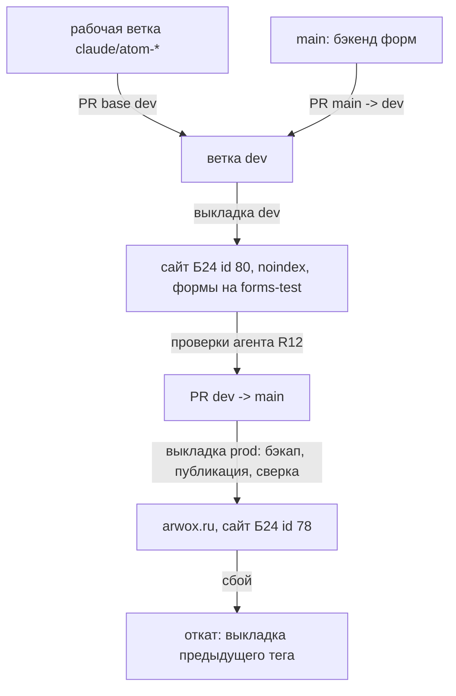

# arwox.ru landing dev/prod - Plan

## Goal Capsule

- **Objective:** любое изменение лендинга arwox.ru сначала видно и проверено на отдельной dev-копии, а живой сайт меняется только из сохранённого в репозитории кода, с откатом одной командой.
- **Means:** код страницы Битрикс24 хранится файлами в репозитории; две ветки (`dev` → dev-сайт, `main` → arwox.ru); выкладка файлов в Битрикс24 через REST.
- **Product authority:** владелец, слова 21.10: «2 ветки дев и прод»; «код храниться файле а потом загружается на сайт»; «нельзя ничего менять пока не сохранить код в репозитории».
- **Open blockers:** нет. Первое действие исполнения — R1–R3 (сохранение прода), до него ни одной записи в Битрикс24.

---

## Product Contract

### Summary

Живой лендинг и все страницы сайта 78 Битрикс24 сохраняются в репозиторий и сверяются с живым сайтом.
После этого dev-окружением становится уже существующий сайт Битрикс24 id 80 (`https://b24-w7skc9.bitrix24site.ru`, закрыт от поиска).
Изменение идёт по пути: рабочая ветка → `dev` → выкладка на dev-сайт и проверки агентом → `main` → выкладка на arwox.ru с бэкапом и откатом.

### Problem Frame

arwox.ru отдаёт страница lid 362 сайта 78 Битрикс24.Сайты: один HTML-блок (черновик 9116, публичный 9120), CSS страницы в `CSSBLOCK_CODE` и additional fields.
React-код v3 в `src/` на сайте не работает.
Правки сегодня идут сразу в прод: dev-копии нет ни в DNS, ни в git, ни в процессе выкладки.

Единственный снимок прода в репозитории (`site78-releases/2026-07-29/`) устарел.
Замер 21.10: живой `CSSBLOCK_CODE` — 64 723 символа, в снимке — 64 785; публичный блок 9120 изменён 08.10.2026, позже снимка.
Если сейчас сломать страницу, восстановить её точное текущее состояние из git нельзя.

Сайт 80 «CODEX ARWOX landing» уже опубликован (HTTP 200), стоит `noindex`, но на нём устаревшая июльская копия.
Его форма отправляет данные напрямую в функцию Yandex Cloud `d4ehurp1jbpj9de0pd6m`; тестовая это функция или боевая — не проверено.

### Key Decisions

- **Dev = существующий сайт Битрикс24 id 80, а не своя копия на нашем сервере.** Страница рендерится тем же движком Битрикс24, что и прод, поэтому агент видит 1:1 то, что увидит посетитель; новый сайт и тариф не нужны. Отвергнуты: копия страницы внутри сайта 78 (общий домен и sitemap с продом), статика через Nginx Proxy Manager (рендер не 1:1), черновик прода (его не видно без входа, риск автопубликации). Governs R4, R5, R6.
- **Ветка `main` играет роль prod; ветка `dev` создаётся один раз.** Переименование `main` в `prod` сломало бы `git-sync`, CI и правило доставки «GitHub напрямую». (session-settled: user-directed — chosen over одной ветки с выкладкой PR на dev-сайт: владелец прямо задал «2 ветки дев и прод».) Governs R7, R8, R9.
- **Источник правды — файлы в репозитории; Битрикс24 только получает их.** Загрузка идёт одной командой-обёрткой через REST (`b24`), байт в байт из файлов. MCP используется только для чтения: передавать 65 КБ CSS через вызов модели ненадёжно. Governs R2, R10.
- **Prod-выкладка не ждёт ручного «да» владельца.** Её открывают пройденные проверки на dev (R12), а защищают бэкап перед записью и откат (R11). Владелец получает ссылки на dev и prod в отчёте. Основание: правило «ЛИНЕЙНОСТЬ» (владелец 10.10). Governs R11, R12.
- **Бэкенд форм остаётся на своём пути через `main`.** У `index.py` и `forms-failover/` уже есть своя тестовая среда `forms-test.arwox.ru`, менять этот рабочий процесс незачем. Ветка `dev` догоняет `main` обратным слиянием (R9).



### Requirements

**Сохранение прода до любых изменений**

- R1. До первой записи в Битрикс24 все 13 страниц сайта 78 сохраняются в репозиторий: HTML блоков (черновик и публичная версия), `CSSBLOCK_CODE` и additional fields. Снимаются только read-методами REST.
- R2. Сохранённые файлы сверяются с живым сайтом повторным чтением. Расхождение хотя бы в одном файле останавливает работу.
- R3. Снимок попадает в `main` через PR со ссылкой на вывод сверки. Только после слияния разрешена первая запись в любой сайт Битрикс24.
- R4. Перед первой перезаписью сайта 80 его текущее содержимое тоже сохраняется в репозиторий по R1–R2.

**Dev-окружение**

- R5. Страница сайта 80 получает код из ветки `dev`. От прода она отличается только адресом отправки форм и запретом индексации.
- R6. Формы dev-страницы отправляют заявки только в `forms-test.arwox.ru`. Ни одна тестовая заявка не попадает в боевой `forms.arwox.ru`.

**Ветки и поток изменений**

- R7. Изменение лендинга идёт по пути: рабочая ветка `claude|codex/<атом>-*` → PR в `dev` → выкладка на dev-сайт → проверки R12 → PR `dev` → `main` → выкладка на прод.
- R8. Каждая выкладка на прод получает git-тег релиза. Тег указывает на коммит, который сейчас на arwox.ru.
- R9. Перед PR `dev` → `main` ветка `dev` содержит все коммиты `main` (обратное слияние `main` → `dev` через PR).

**Выкладка и откат**

- R10. Одна команда выкладывает выбранную среду (`dev` или `prod`) из файлов текущего коммита; успех — только когда живая страница отдаёт новую версию.
- R11. Откат прода — выкладка предыдущего тега командой R10; перед каждой записью в прод живое состояние сохраняется по R1.

**Проверки, которые агент проводит на dev**

- R12. До PR в `main` агент проверяет dev-страницу автоматически:
  - все секции на месте и в нужном порядке;
  - 3 формы отправляют данные на адрес своей среды;
  - в браузере нет ошибок консоли, страница проверена на мобильной и десктопной ширине;
  - размер CSS не превышает лимит поля.

  Вывод проверок прикладывается к телу PR.

**Инструкции агентам**

- R13. `AGENTS.md` проекта получает раздел «Лендинг dev/prod»: среды (сайт, страница, адрес, адрес форм), поток веток по R7, правило R1–R3, команды выкладки и отката, проверки R12. Там же запреты: правка прода в редакторе Битрикс24 мимо репозитория и прямая выкладка на прод без dev.
- R14. Маршрут доставки в `AGENTS.md` — «GitHub напрямую» вместо отключённого `ship-post`; `CLAUDE.md` не меняется и импортирует `@AGENTS.md`, поэтому Claude и Codex читают одни правила.

### Acceptance Examples

- AE1. **Covers R2, R3.** Given снимок записан, When повторное чтение `CSSBLOCK_CODE` даёт другую длину, Then работа стоит, запись в Битрикс24 не выполняется.
- AE2. **Covers R6.** Given dev-страница выложена, When агент ищет в её HTML адреса отправки форм, Then все 3 адреса — `forms-test.arwox.ru`.
- AE3. **Covers R11.** Given новая версия выложена на прод, When проверка живой страницы не находит маркер новой версии, Then команда выкладывает предыдущий тег, и сверка показывает совпадение с ним.
- AE4. **Covers R9.** Given в `main` слит фикс бэкенда, When открывается PR `dev` → `main`, Then в нём нет отката этого фикса.

### Scope Boundaries

- Красивый адрес `dev.arwox.ru` (CNAME у Beget на `lb.bitrix24site.ru`) отложен: для проверок хватает адреса сайта 80.
- Улучшения содержимого лендинга — отдельные атомы после R1–R14 (см. ниже).
- Перенос React v3 из `src/` на сайт вне цели.
- DNS `forms.arwox.ru`, бэкенд форм и функции Yandex Cloud не меняются.
- Правки Битрикс24 через визуальный редактор вне процесса; процесс их не синхронизирует.

### Dependencies / Assumptions

- Вебхук `b24` читает и пишет `landing.*`. Чтение проверено 21.10 (`landing.site.getList`, `landing.block.getlist`, `landing.landing.getadditionalfields`); запись проверена замером U3 21.10 на lid 368 (`landing/README.md` §«Замеры REST»).
- Лимит `CSSBLOCK_CODE` — 65 535 байт UTF-8 (замер U3): сверх лимита Битрикс24 молча обрезает CSS и отвечает `true`. Главная прода: 64 723 символа = 64 757 байт, запас 778 байт.
- Автопубликация не действует на запись через REST (замер U3): `updatecontent` меняет только черновик, публичный блок и живая страница меняются только после `landing.landing.publication`.

### Outstanding Questions

**Deferred to Planning**

- Как dev-страница меняет адрес форм на `forms-test`: подстановкой при выкладке или отдельным файлом настроек среды.
- Куда девать запас CSS в 800 символов: сжатие или вынос части стилей.
- Что делать со служебной страницей отката сайта 80 (lid 372): сохранить по R4 и решить при планировании.

---

## Planning Contract

Product Contract preservation: R1–R14 и AE1–AE4 перенесены без изменения смысла; Outstanding Questions закрыты решениями KTD3, KTD6, KTD7.

### Key Technical Decisions

- KTD1. Один bash-скрипт `landing/b24-landing.sh` с режимами `snapshot`, `verify`, `deploy`, `rollback`; REST через уже установленный `b24`, JSON через `jq`. Новых зависимостей нет. Тест `landing/b24-landing-test.sh` — чёрный ящик с заглушкой `b24` в PATH, по образцу `forms-failover/forms-ctl-test.sh`. Covers R1, R2, R10, R11.
- KTD2. Раскладка снимка: `landing/site<SITE>/<lid>/` с файлами `block-<id>.draft.html` и `block-<id>.public.html` (ответ `landing.block.getlist` с `get_content=1`, `edit_mode` 1 и 0, байт в байт), `additional-fields.json` (`landing.landing.getadditionalfields`, целиком) и `cssblock.css` (поле `CSSBLOCK_CODE` из него, для правок и диффа). `verify` перечитывает те же методы и сравнивает побайтно. Covers R1, R2, AE1.
- KTD3. Различие сред задаётся подстановкой при выкладке. В файлах всегда боевой адрес `https://forms.arwox.ru/`. `deploy dev` меняет его на `https://forms-test.arwox.ru/` и отказывает, если после подстановки хоть один `action=` формы ведёт на другой адрес. `noindex` — настройка сайта 80, выкладка её не трогает. Covers R5, R6, AE2.
- KTD4. Выкладка: обёртка `<div id="b<id>" …>` снимается, `landing.block.updatecontent` пишет черновик, `landing.landing.update` пишет `CSSBLOCK_CODE`, `landing.landing.publication` публикует. Успех — перечитанный публичный блок совпадает с выложенным содержимым. Замер U3: Битрикс24 HTML не нормализует (221 469 символов туда и обратно, равенство побайтно без обёртки), id публичного блока после публикации не меняется — сравнение идёт напрямую, маркер релиза не нужен. Covers R10, AE3.
- KTD5. Перед записью в прод живое состояние снимается и сравнивается с файлами последнего тега `landing-prod-*`. Расхождение (правка в редакторе мимо репозитория) останавливает выкладку: сначала снимок в git по R1. Совпадение означает, что бэкап — сам тег, а откат — `rollback <тег>`, то есть выкладка файлов тега через `git show`. Пока тега `landing-prod-*` нет, база сравнения и отката — файлы `landing/site78` в `main` (снимок PR-1, сверенный `verify 78`). Covers R8, R11.
- KTD6. Лимит длины CSS — константа скрипта 65 535 байт (замер U3: обрезка по байтам UTF-8, без ошибки). `deploy` отказывает до записи, если `cssblock.css` длиннее 65 535 байт (`wc -c`), и после записи сверяет перечитанный CSS с файлом. Как использовать остаток в 778 байт, решают атомы улучшений, не этот план. Covers R12.
- KTD7. Сайт 80: lid 368 — dev-страница; lid 372 только сохраняется снимком (R4), выкладка её не трогает.
- KTD8. До первой выкладки на dev формы сайта 80 никто не отправляет. Сейчас они ведут в функцию `codex-w7skc9-quiz-submit` (`d4ehurp1jbpj9de0pd6m`), куда она передаёт заявки, — не проверено. Проверки R12 сверяют адреса форм статически, без отправки. Живая отправка остаётся за `forms-ctl.sh test`. Covers R6.
- KTD9. Порядок доставки по R3: PR-1 (U1 и U2, только чтение) сливается в `main` раньше любой записи в Битрикс24. U3–U6 идут после слияния PR-1. Ветка `dev` создаётся от `main` после PR-1.

### High-Level Technical Design

*Направление, не спецификация.*

| Режим | Чтение Б24 | Запись Б24 | Цель |
|---|---|---|---|
| `snapshot <site> <dir>` | да | нет | файлы KTD2 |
| `verify <site> <dir>` | да | нет | rc 0 только при побайтном совпадении |
| `deploy dev` | да | сайт 80, lid 368 | подстановка KTD3 |
| `deploy prod` | да | сайт 78, lid 362 | KTD5, затем тег |
| `rollback <tag>` | да | сайт 78, lid 362 | файлы тега |

```mermaid
sequenceDiagram
  participant S as b24-landing.sh deploy
  participant G as git (файлы коммита)
  participant B as Битрикс24 REST
  S->>G: файлы lid 362 (блок, cssblock.css)
  S->>S: dev: подстановка forms-test, проверка action=; длина CSS ≤ лимит
  S->>B: prod: snapshot + сравнение с последним тегом (стоп при расхождении)
  S->>B: landing.block.updatecontent (черновик)
  S->>B: landing.landing.update (CSSBLOCK_CODE)
  S->>B: landing.landing.publication
  S->>B: getlist edit_mode=0 → сравнение с выложенным
  S->>G: prod: git tag landing-prod-<дата>-<sha>
```

---

## Implementation Units

- U1. **Скрипт снимка и сверки.** Файлы: `landing/b24-landing.sh` (режимы `snapshot`, `verify`), `landing/b24-landing-test.sh`. Решения: KTD1, KTD2. Requirements: R1, R2.
  - Execution note: сначала тест (красный), потом скрипт.
  - Test scenarios:
    - заглушка `b24` отдаёт 2 страницы с 1 блоком каждая → `snapshot` создаёт по 4 файла на страницу, содержимое совпадает с ответом заглушки байт в байт;
    - после `snapshot` заглушка меняет длину `CSSBLOCK_CODE` → `verify` rc ≠ 0 и называет файл (AE1);
    - без изменений → `verify` rc 0 и печатает `ok=<N> failed=0`;
    - заглушка `b24` падает (rc 1) → `snapshot` rc ≠ 0, частичных файлов не оставляет.
- U2. **Снимок сайтов 78 и 80 в git.** Файлы: `landing/site78/**` (13 страниц), `landing/site80/**` (lid 368, 372), `landing/README.md` (раскладка, команды). Решения: KTD2, KTD7, KTD9. Requirements: R1–R4.
  - Test expectation: none — данные. Доказательство — вывод `verify 78` и `verify 80` с `failed=0` в теле PR-1.
- U3. **Замеры на сайте 80 (после слияния PR-1).** Только lid 368, порядок:
  1. no-op запись: `updatecontent` тем же содержимым черновика, затем `verify 80`;
  2. автопубликация: публичный блок до и после записи черновика без `publication`;
  3. нормализация HTML: совпадает ли публичный блок после `publication` с записанным;
  4. лимит CSS: запись `CSSBLOCK_CODE` длиной 65 535 и 65 536, затем возврат исходного CSS из снимка и `verify 80`.

  Результаты — таблица в `landing/README.md` и значения KTD4, KTD6. Requirements: снимает три пункта Dependencies.
  - Test expectation: none — замер. Итог — `verify 80` rc 0 после возврата.
- U4. **Выкладка и откат.** Файлы: `landing/b24-landing.sh` (режимы `deploy`, `rollback`), `landing/b24-landing-test.sh`. Решения: KTD3–KTD6. Requirements: R5, R6, R8, R10, R11.
  - Test scenarios:
    - `deploy dev`: заглушка получает `updatecontent` с `forms-test.arwox.ru` во всех 3 `action=` и без `forms.arwox.ru` (AE2);
    - `deploy dev` по HTML, где одна форма ведёт на чужой адрес → rc ≠ 0, ни одного write-вызова;
    - CSS длиннее лимита → rc ≠ 0 до записи;
    - `deploy prod` при живом состоянии, отличном от последнего тега → rc ≠ 0, ни одного write-вызова (KTD5);
    - публичный блок после публикации не совпадает → скрипт сам выкладывает файлы предыдущего тега (без тега — базу KTD5), сверка с ними совпадает, итог rc ≠ 0 с текстом «откат выполнен» (AE3);
    - `rollback <тег>`: заглушка получает содержимое файлов этого тега (`git show`), сверка rc 0.
- U5. **Проверки dev-страницы.** Режим `check <url>` в том же скрипте: 15 секций в порядке Appendix, 3 `action=` форм на адрес среды, длина CSS ≤ лимит. Консоль и ширина экрана проверяются браузером (`ce-test-browser`), без отправки форм. Решения: KTD8. Requirements: R12.
  - Test scenarios: HTML-фикстура с переставленными секциями → rc ≠ 0 с именем секции; 2 из 3 форм на `forms-test` → rc ≠ 0.
  - Живой шаг (после слияния U4): `deploy dev` файлов `landing/site78/362` на lid 368, затем `check https://b24-w7skc9.bitrix24site.ru/`. Вывод обеих команд — в тело PR; это доказательство строки «адреса форм dev». Requirements: R5, R12.
- U6. **Ветка `dev` и правила агентам.** Ветка `dev` от `main` после PR-1. В `AGENTS.md` — раздел «Лендинг dev/prod»: среды, поток R7, правило R1–R3, команды, проверки R12, запреты R13. Строка доставки `AGENTS.md:43` получает маршрут «GitHub напрямую». Requirements: R7, R9, R13, R14, AE4.
  - Test expectation: none — документ и ветка. Проверка — `git ls-remote origin dev` и `grep -n` по разделу.

Зависимости: U1 → U2 → (PR-1 слит) → U3 → U4 → U5; U6 после PR-1.

---

## Verification Contract

| Проверка | Команда | Ожидание |
|---|---|---|
| тесты скрипта | `bash landing/b24-landing-test.sh` | все сценарии PASS, rc 0 |
| снимок прода совпадает с живым | `bash landing/b24-landing.sh verify 78 landing/site78` | `failed=0`, rc 0 |
| снимок dev совпадает с живым (в PR-1, до живого шага U5) | `bash landing/b24-landing.sh verify 80 landing/site80` | `failed=0`, rc 0 |
| PR-1 до записи | `gh pr view <PR-1> --json state,mergedAt` | MERGED раньше первого write-вызова U3 |
| адреса форм dev (после `deploy dev`, U5) | `bash landing/b24-landing.sh check https://b24-w7skc9.bitrix24site.ru/` | 3 из 3 на `forms-test` |
| ветка dev | `git ls-remote origin dev` | одна строка |

## Definition of Done

- Все 6 проверок Verification Contract дали ожидаемый результат, их вывод лежит в телах PR.
- Три пункта Dependencies / Assumptions заменены замерами U3.
- Прод (сайт 78) не получил ни одного write-вызова: в этом плане выкладка на прод не запускается, потому что изменений содержимого нет.

---

<!-- ce-section: work-relationships -->
## How This Work Fits Together

Этот план покрывает первый участок — сохранение прода и dev/prod.
Разбивка ниже — текущее понимание, а не обязательная дорожная карта.

- Улучшения лендинга по аудиту 21.10. Depends on R1–R12: каждое идёт через dev. Найдено замером:
  - нет JSON-LD (0 блоков);
  - sitemap содержит 9 URL раздела `/legal` и не содержит главную;
  - на странице нет ИНН и ОГРН;
  - HTML весит 341 455 байт.
- Структура лендинга (ниже). Shares R13: описание секций входит в `AGENTS.md`.
- Новый лендинг-хаб в `arwox-xxx` (план другой сессии). Can proceed independently of: это другой сайт.
- `dev.arwox.ru`. Still to decide: нужен ли он после первых релизов.

---

## Appendix

### Current landing structure (arwox.ru, замер 21.10)

| # | Секция (`id`) | Назначение |
|---|---|---|
| 1 | `hero` | первый экран, оффер, CTA |
| 2 | `results` | цифры результатов |
| 3 | `demo` | демонстрация |
| 4 | `case` | кейс клиента |
| 5 | `why-us` | почему ARWOX |
| 6 | `process` | этапы работы |
| 7 | `packages` | пакеты услуг |
| 8 | `integrations` | интеграции |
| 9 | `partners` | партнёрство Битрикс24 |
| 10 | `certificates` | сертификаты |
| 11 | `bitrixgpt` | ИИ в Битрикс24 |
| 12 | `tariffs` | тарифы |
| 13 | `faq` | вопросы |
| 14 | `websites` | сайты |
| 15 | `contact` | контакты, форма |

Формы: 3 (квиз, попап, футер), все отправляют данные на `https://forms.arwox.ru/`.
Юридические страницы: 12 страниц сайта 78 (lid 374–396).

### Sources

- Сайты и страницы: `b24 landing.site.getList`, `b24 landing.landing.getList` (SITE_ID 78, 80), `b24 landing.site.getPublicUrl` → 78 `https://arwox.ru`, 80 `https://b24-w7skc9.bitrix24site.ru`.
- Устаревание снимка: `CSSBLOCK_CODE` live 64 723 и файл 64 785 (`jq length`); блок 9120 `DATE_MODIFY` 08.10.2026.
- Процедура отката из файлов: `site78-releases/2026-07-29/README.md:14-32`.
- Среды форм: `architecture.md:35,58`.
- Методы REST: документация Битрикс24 `landing.block.updatecontent` (пишет «в черновике страницы»), `landing.landing.publication`.
- Модели веток: Driessen, «A successful Git branching model» (примечание 2020 о continuous delivery); GitLab flow (production branch); trunkbaseddevelopment.com.
